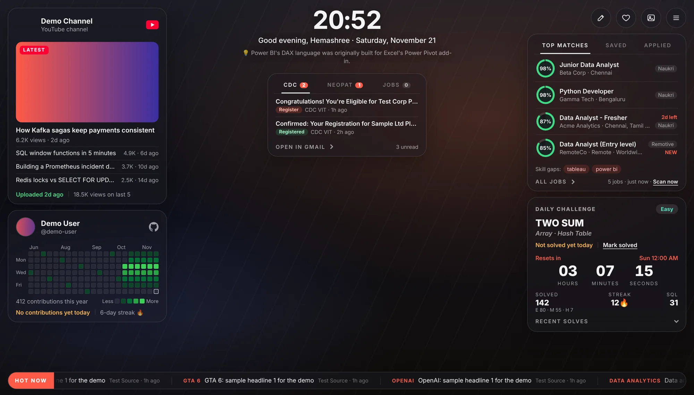
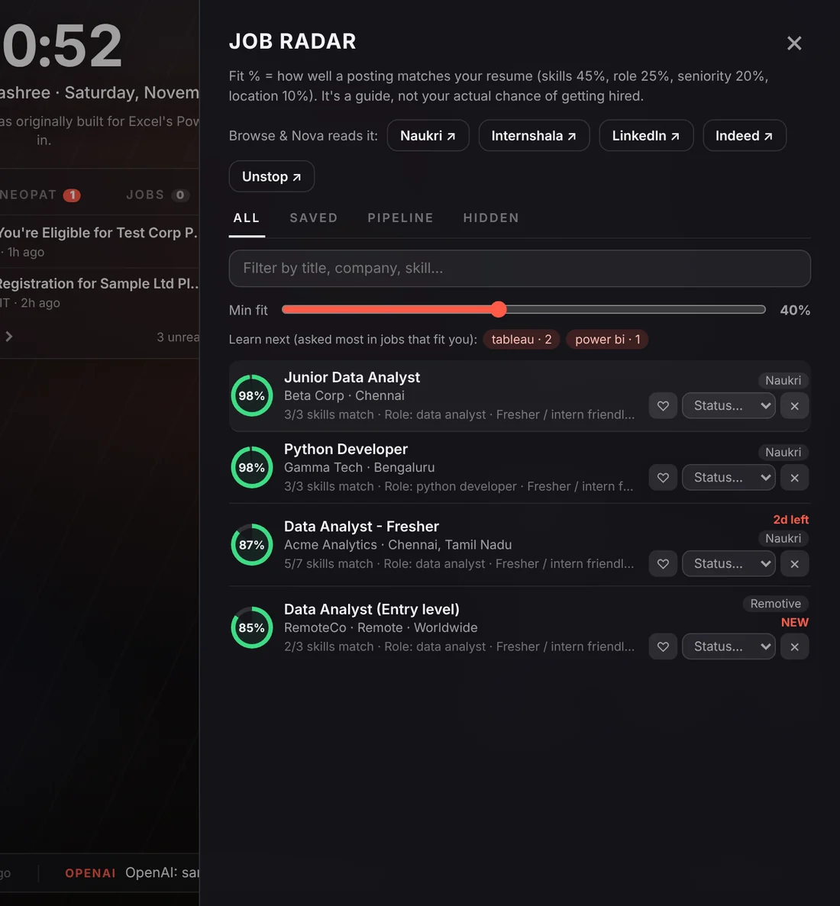
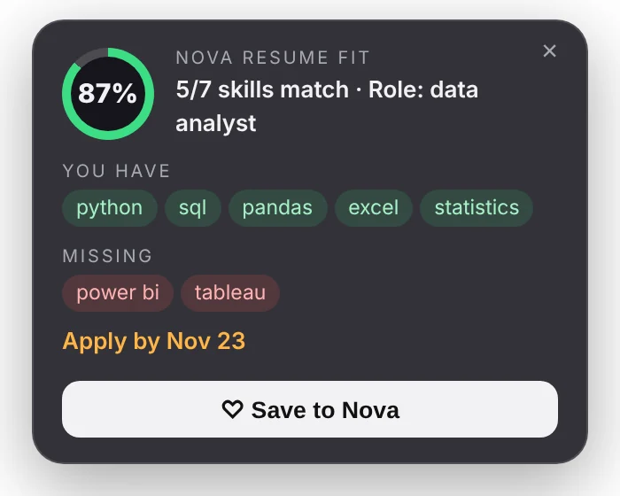
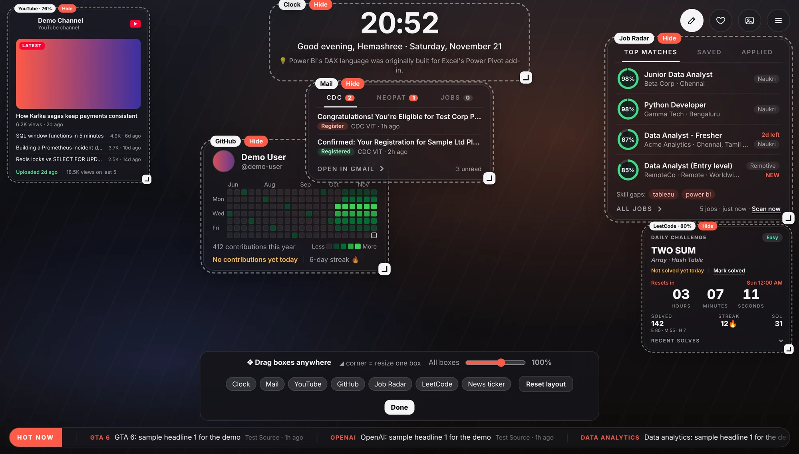
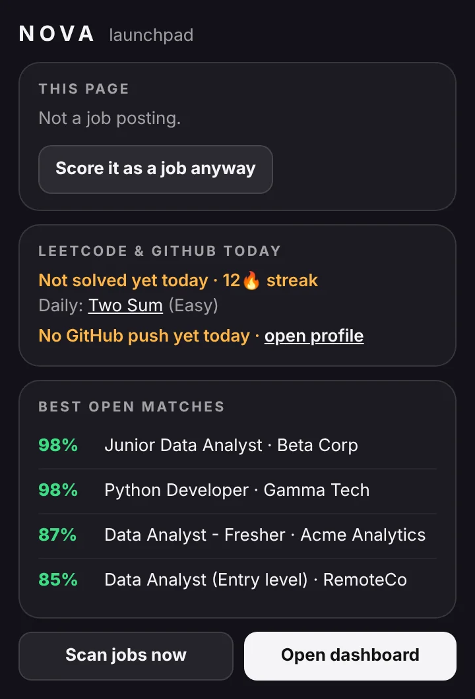
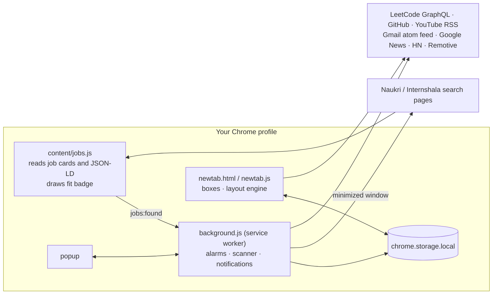

# Nova Launchpad

**A Chrome new tab that runs my job hunt.** It scores job postings from Naukri, Internshala, LinkedIn and others against my resume. It also tracks my LeetCode and GitHub streaks, surfaces CDC placement mail and my YouTube channel, and nudges me before I lose a streak or miss a deadline.



<sub>Screenshot with demo data.</sub>

---

<p align="center"><a href="https://github.com/HemashreeVI/portfolio-extension/releases/latest"></a></p>

> **Install in 1 minute:** download the `.zip` from the [latest release](https://github.com/HemashreeVI/portfolio-extension/releases/latest) → unzip it → open `chrome://extensions` → turn on **Developer mode** → **Load unpacked** → pick the unzipped folder.

## Why I built it

Job hunting as a student meant juggling a dozen tabs every day: Naukri, Internshala, LinkedIn, Gmail for CDC drives, LeetCode for the daily problem, GitHub to keep the streak alive, YouTube Studio. Most job alerts were irrelevant, and the important CDC mails got buried.

Nova puts all of that on the one page I open most often, the new tab:
- It **ranks** jobs instead of just listing them.
- It shows **what skills I'm missing** for the jobs that fit me.
- It **reminds me** only when something actually needs doing.

## Features

### 🎯 Job Radar: resume-fit scoring
- **Every job gets a fit % against my resume:**
  - skills (45%)
  - role (25%)
  - seniority, since I'm a 2027 graduate (20%)
  - location (10%)

  A "5+ years" posting can't score high no matter how many skills match.
- **Shows the skills you're missing**, and aggregates the most-requested missing skills across all well-fitting jobs. That tells me what to learn next, e.g. *Power BI*, *Tableau*.
- **Reads deadlines** ("Apply by 5 Dec") and reminds me 2 days before.
- **Status pipeline:** Saved → Applied → OA / Test → Interview → Offer.

<p align="center"> </p>

### 🔎 Where the jobs come from
| Source | How |
|---|---|
| Naukri, Internshala | Auto-scanned every few hours: saved searches open in a minimized window, get read, and close |
| LinkedIn, Indeed, Unstop, Wellfound, Instahyre, foundit, Glassdoor, company career pages | Read while you browse them, and a fit badge appears on job pages |
| Any site with schema.org `JobPosting` data | Parsed directly (title, company, location, skills, `validThrough` deadline) |
| Remotive | Public JSON API |

### 📩 Mail: CDC, NeoPAT, job alerts
- Comes with importable **Gmail filters** (`gmail-filters.xml`) that sort placement mail into labels:
  - **CDC:** placement drives, eligibility, registrations.
  - **NeoPAT:** tests and reminders.
  - **Jobs:** job-site alerts, kept out of the inbox.
  - **LinkedIn:** messages, which can be recruiters.
- The Mail box shows unread mail per label, and tags each mail **Register**, **Registered** or **Due 28 Nov**.
- A desktop notification arrives when new CDC or NeoPAT mail lands.

### 💻 LeetCode + GitHub
- **LeetCode:** today's daily problem, a countdown to the 05:30 IST reset, solved counts (Easy/Medium/Hard), streak and SQL count.
- **GitHub:** profile plus the **real contribution calendar** in GitHub's own colours.
- **One evening reminder** (7:00 pm and 10:30 pm), sent **only if** there's no accepted LeetCode submission or no GitHub contribution that day.

### ▶️ YouTube
- Channel card with the latest upload, recent videos and views.
- A gentle "time for a new one?" when the last upload is a week old.

### 🧩 Your layout
- **Edit mode (✎):**
  - Drag any box anywhere.
  - Resize a single box from its corner (60–180%).
  - Hide boxes, or scale everything at once.
- **Saved per browser profile**, so every new tab opens the same way.
- Use your own wallpaper, and a tech-news ticker (Google News topics + Hacker News) with rotating "did you know" facts.

<p align="center"> </p>

## How it works



- **No backend, no API keys, no build step.** Plain ES modules, about 2.8k lines.
- **Fit scoring** (`lib/match.js`):
  - A vocabulary of ~65 skills with aliases (e.g. `postgres` → `postgresql`, `power ?bi|dax` → `power bi`) is matched with word-boundary regexes.
  - The score is coverage of the job's skills, plus role match, seniority (catches "Senior", "Lead" and "N+ years"), and preferred locations.
- **Scanning:** the service worker opens a search page in a minimized window, waits for the content script to report the cards it read (with a settle timer and a hard timeout), then closes the window. Each source's result (`N read`, or why it failed) is shown in Settings, so a layout change on a job site is visible rather than silent.
- **Safe by construction:**
  - Every piece of text from the web is inserted with `textContent`, never `innerHTML`.
  - Job descriptions are parsed with `DOMParser`, which builds an inert document, so nothing in them runs.
  - The on-page badge lives in a closed Shadow DOM.
  - Links are restricted to `http(s)`.
- **Reliability:**
  - API responses are cached with a stale fallback, so the page renders offline.
  - Storage writes from many tabs go through one promise queue, so concurrent reports never overwrite each other.
  - Alarms survive the MV3 service worker being suspended.
- **Layout engine:**
  - Boxes are absolutely positioned on a zoomable board, and positions are saved as fractions of the viewport so they adapt to other screen sizes.
  - Per-box size uses `transform: scale`, so positions stay untouched.
  - Narrow windows fall back to a stacked, scrollable layout.

## Install

1. Download this repo (**Code → Download ZIP**) and unzip it, or `git clone` it.
2. Open `chrome://extensions` and turn on **Developer mode** (top right).
3. Click **Load unpacked** and select the folder that contains `manifest.json`.
4. Open a new tab. If Chrome asks about the new-tab page, choose **Keep it**. Turn off any other extension that controls the new tab.
5. Settings (☰) opens on first run:
   - Add your name, LeetCode username, GitHub username and YouTube channel.
   - Check the job searches and your resume skills, then click **Save**.
6. *(Optional)* Gmail: Settings → Gmail → download the filters, then in Gmail go to ⚙ → See all settings → Filters and Blocked Addresses → **Import filters**.
7. Click **Send a test notification** to make sure your OS allows Chrome notifications.

**Updating:** pull or download the new version into the same folder, then click **↻** on the extension in `chrome://extensions`. Settings, saved jobs and layout are kept.

## Privacy and permissions

Everything (settings, profile, jobs, layout) is stored in `chrome.storage.local` in your browser. Nothing is sent to any server of mine; there isn't one. **Export / Import backup** in Settings moves your data between computers.

| Permission | Why |
|---|---|
| `storage`, `unlimitedStorage` | Your settings, jobs and wallpaper |
| `alarms`, `notifications` | Reminders, scans, alerts |
| `contextMenus`, `activeTab` | Right-click "Save this job", and scoring the current page from the popup |
| Job sites (content script) | Reading job listings you view, and drawing the fit badge |
| `leetcode.com`, `api.github.com`, `github.com/users/*` | Your stats and contribution calendar |
| `www.youtube.com` | Your channel page and its public RSS feed |
| `mail.google.com` | Gmail's unread-mail feed for your labels, using your signed-in session (no password stored) |
| `news.google.com`, `hn.algolia.com`, `remotive.com` | News ticker and remote jobs |

## Limitations

- **Fit % is a resume match, not a hiring probability.** It's for deciding what to apply to first.
- **Job sites change their HTML.** If a source keeps showing `0 read`, its selectors in `content/jobs.js` need updating. Pages with `JobPosting` JSON-LD keep working regardless.
- **Scans and reminders only run while Chrome is open.**
- **Desktop only.** Chrome on Android and iOS doesn't support extensions.
- **The Gmail box uses Gmail's long-standing atom feed** (unread mail only). If Google retires it, the box shows an error rather than wrong data.

## Project structure

```
manifest.json        MV3 manifest
background.js        service worker: alarms, reminders, Naukri/Internshala scanner, notifications
content/jobs.js      reads job cards and JSON-LD on job sites, draws the fit badge
newtab.html/.css/.js the new tab: boxes, drawers, settings, drag/resize layout engine
popup.html/.css/.js  toolbar popup: score the current page, today's status
lib/profile.js       resume profile + skill vocabulary
lib/match.js         fit scoring, deadline parsing
lib/jobs.js          job store: de-duplication, scoring, pruning, skill gaps
lib/feeds.js         LeetCode, GitHub, YouTube, Gmail, news, Remotive
lib/store.js         storage helpers + cache with stale fallback
gmail-filters.xml    importable Gmail filters
docs/                README screenshots
```

## Tech

JavaScript (ES modules), Chrome Extensions Manifest V3 (service worker, alarms, notifications, content scripts, Shadow DOM), LeetCode GraphQL, GitHub REST, RSS/Atom parsing, schema.org JobPosting, CSS (glassmorphism, grid, `zoom`/`transform` layout).
